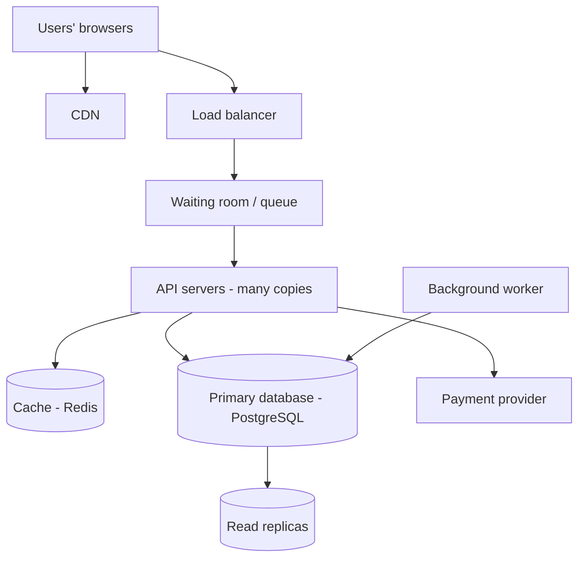

# TicketHub: System Design

TicketHub is a website that sells tickets for concerts and events. The hardest part of the design is the "big sale": a very popular concert goes on sale and far more people than seats arrive at the same moment.

## 1. Requirements

### Functional requirements

- Users can register and log in.
- Users can browse and search upcoming events.
- Users can view an event's details and its seat map (which seats are free).
- Users can select seats and hold them for a short time while they pay.
- Users can pay for held seats.
- Users can view the tickets they have bought.
- Held seats that are not paid for are released automatically.

### Non-functional requirements

- **Speed:** Pages and seat maps load in under 2 seconds on a normal day. During a big sale they stay under 3 seconds even with 200,000 people online. Holding a seat gives an answer (success or "taken") in under 1 second.
- **Correctness:** A seat is never sold to two people. A customer is never charged without getting a ticket, and never gets a ticket without paying. A hold that is not paid for expires and the seat becomes available again.
- **Fairness:** People are served in the order they arrive, so refreshing the page repeatedly does not give anyone an advantage. Each person is limited to 4 tickets per event so bots and resellers cannot grab the whole venue.
- **Availability:** The site stays up during a big sale. If it gets overloaded, it slows down gracefully (for example, a waiting room) instead of crashing for everyone.

## 2. Estimates

### Normal day

| Quantity | Calculation | Result |
|---|---|---|
| Page views per day | 50,000 visitors x 10 pages | 500,000 |
| Average page views per second | 500,000 / 86,400 seconds | about 6 per second |
| Busy-hour peak (assume 10x the average) | 6 x 10 | about 60 per second |
| Tickets sold per day | given | 5,000 |
| Tickets sold per second (average) | 5,000 / 86,400 | about 0.06 per second |

A normal day is very light. A single modest server could handle it.

### Big sale (one popular concert)

Assumption: each of the 200,000 buyers makes about 10 requests (opening the event, looking at the seat map a few times, trying to hold seats).

| Quantity | Calculation | Result |
|---|---|---|
| Buyers arriving per second | 200,000 / 600 seconds (10 minutes) | about 333 per second |
| Requests per second | 333 x 10 | about 3,300 per second |
| Seats sold per second | 20,000 / 600 | about 33 per second |
| Buyers per seat | 200,000 / 20,000 | 10 buyers for every seat |

### Comparison

| | Normal day | Big sale | Increase |
|---|---|---|---|
| Requests per second | about 6 | about 3,300 | about 550x |
| Tickets per second | about 0.06 | about 33 | about 550x |

Traffic jumps about 550 times, and it all lands in 10 minutes. That is why we cannot size the system for a normal day. Also, 9 out of 10 buyers will not get a ticket, so the design must treat them fairly and tell them quickly.

## 3. API Design

All endpoints use JSON. Endpoints marked "login required" need a valid token.

| Method and path | Purpose | Notes |
|---|---|---|
| `POST /auth/register` | Create an account | |
| `POST /auth/login` | Log in and get a token | |
| `GET /events` | Browse events | Supports `?search=` and `?page=`. Cached. |
| `GET /events/{id}` | Event details | Cached. |
| `GET /events/{id}/seats` | View seats and whether each is free | Cached for a few seconds. |
| `POST /events/{id}/holds` | Hold seats for 10 minutes | Login required. Body: `{ "seat_ids": [101, 102] }`. Returns `201` with `hold_id` and `expires_at`, or `409` if a seat is taken. |
| `DELETE /holds/{id}` | Release a hold early | Login required. |
| `POST /orders` | Pay for a hold | Login required. Body: `{ "hold_id": 55 }`. Needs an `Idempotency-Key` header so a double click never charges twice. |
| `GET /me/tickets` | View my tickets | Login required. |

Example: holding seats

```
POST /events/7/holds
{ "seat_ids": [101, 102] }

201 Created
{ "hold_id": 55, "expires_at": "2026-10-16T18:10:00Z" }

409 Conflict
{ "error": "Seat 102 is no longer available" }
```


## 4. Data Model

Five tables (PostgreSQL, a relational database).

**users**: `id` (PK), `name`, `email` (unique), `password_hash`, `created_at`

**events**: `id` (PK), `title`, `venue`, `starts_at`, `on_sale_at`, `total_seats`

**seats**: `id` (PK), `event_id` (FK to events), `section`, `row`, `number`, `price`, `status` (`available`, `held`, `sold`), `held_by` (FK to users, nullable), `hold_expires_at` (nullable). Unique on (`event_id`, `section`, `row`, `number`).

**orders**: `id` (PK), `user_id` (FK to users), `event_id` (FK to events), `total_amount`, `payment_status`, `idempotency_key` (unique), `created_at`

**tickets**: `id` (PK), `order_id` (FK to orders), `seat_id` (FK to seats, **UNIQUE**), `user_id` (FK to users)

Relationships:
- One user has many orders. One order has many tickets.
- One event has many seats.
- One seat has at most one ticket (enforced by the UNIQUE constraint on `tickets.seat_id`).

## 5. Preventing Double-Booking

Two protections work together: an atomic hold (the normal path) and a database constraint (the safety net).

**Protection 1: an atomic hold inside a transaction.** When a user asks to hold seats, the server runs one transaction:

```sql
BEGIN;

UPDATE seats
SET status = 'held', held_by = :user_id,
    hold_expires_at = now() + interval '10 minutes'
WHERE id IN (:seat_ids)
  AND (status = 'available' OR hold_expires_at < now());

-- if rows updated = number of seats requested: COMMIT
-- otherwise: ROLLBACK and return 409
```

The check ("is it free?") and the change ("take it") are a single statement, so there is no gap between them. When two people click the same seat at the same moment, the database locks that row. The first transaction updates it and commits. The second waits, then re-checks the condition, sees the seat is no longer available, updates 0 rows, and gets a `409`. Only one person can ever win. If a user asked for 2 seats and only 1 was free, the rollback frees the first one, so nobody ends up with half an order.

**Protection 2: a UNIQUE constraint as a safety net.** `tickets.seat_id` is UNIQUE. Even if a bug in our code tried to sell the same seat twice, the database would reject the second ticket. The rule is enforced by the database, not by hoping our code is right.

**Payment step.** When the user pays, the server checks that the hold still belongs to them and has not expired. Then it creates the order and tickets and marks the seats `sold` in one transaction. If payment fails, the transaction rolls back and the hold simply expires. The `Idempotency-Key` stops a double click from creating two orders.

**Expiry.** A background worker runs every minute and sets expired holds back to `available`. The `hold_expires_at < now()` check in the hold query means a seat is usable again even if the worker is late.

**Why not check in the cache?** The cache may be a few seconds out of date, so it is only used for *showing* the seat map. The final decision is always made by the database.

## 6. Architecture



**Components**

- **CDN:** Serves images, scripts and static pages from servers close to the user. This takes most of the load off our own servers.
- **Load balancer:** Spreads requests evenly across the API servers and stops sending traffic to a server that is down.
- **Waiting room:** During a big sale, people enter a queue in the order they arrive and are let in at a rate the system can handle (for example 500 people per second). This is how we get fairness and protect the database from 200,000 people at once.
- **API servers:** Run the business logic (hold, pay, view tickets). They keep no state between requests, so we can add more copies when traffic grows.
- **Cache (Redis):** Stores event details and the seat map for a few seconds. Most of the 3,300 requests per second are reads, and the cache answers them without touching the database.
- **Primary database (PostgreSQL):** The single source of truth. All holds, orders and tickets are written here, in transactions, so double-booking cannot happen.
- **Read replicas:** Copies of the database that answer read-only queries such as browsing events and viewing my tickets.
- **Payment provider:** An outside service that takes the card payment. We never store card numbers.
- **Background worker:** Releases expired holds and sends confirmation emails, so the user does not wait for them.

**How it survives the big sale**

1. The CDN and cache answer most read traffic (about 3,300 requests per second becomes a small number reaching the database).
2. The waiting room limits how many people reach the booking step at once, and treats them in arrival order.
3. Only the writes that matter (holds and orders, at most about 33 successful per second) reach the primary database, which can handle that rate.
4. People who lose a race get a fast `409`, and when the seats run out, a clear "sold out" message.

## 7. Trade-offs

1. **Correctness versus speed (database versus cache for holds).** We decide every hold in the database instead of the faster cache. This is slower, but a seat can never be sold twice. Selling a seat twice is far worse than a response that takes a few milliseconds longer. We accept the cost, and the waiting room keeps the database load low enough.

2. **Fairness versus convenience (the waiting room).** The queue makes the sale fair and protects the system, but users must wait and cannot just click straight in. Some will find that annoying. We accept it because the alternative is a crashed site where the fastest connections win.

3. **Hold time: long versus short.** A 10-minute hold gives people time to pay, but while seats are held nobody else can buy them, and bots could hoard seats. A short hold frees seats faster but makes users panic and fail at checkout. We chose 10 minutes with a 4-ticket limit as a middle path.

4. **Slightly stale seat map.** The cached seat map can be a few seconds old, so a user may click a seat that was just taken and get a `409`. We accept this small annoyance to keep the site fast, because the database still makes the final decision.
